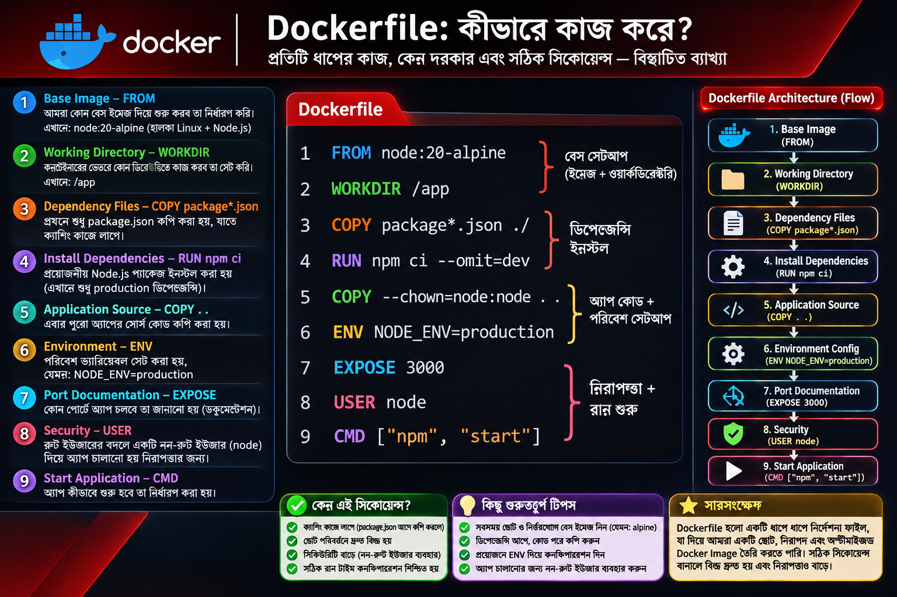
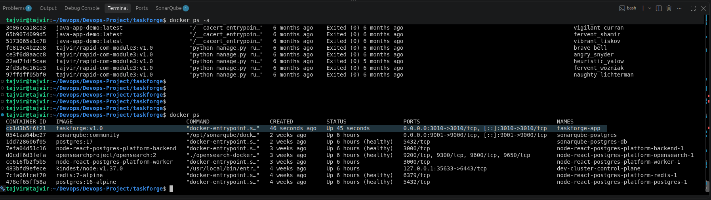
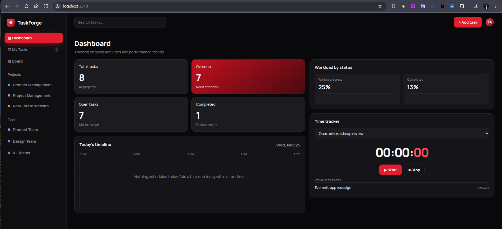
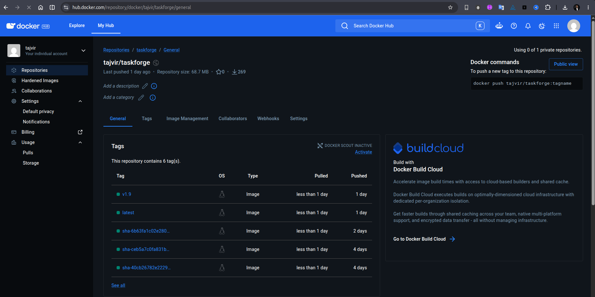

# 🐳 TaskForge - Docker

## 1. Objective

Containerize the TaskForge Node.js + Express application, run it
locally, and publish versioned Docker images to Docker Hub through
GitHub Actions.

## 2. Application and Docker configuration

TaskForge uses Node.js + Express with SQLite. The application listens on
port `3010`.

-   **Dockerfile:** `Dockerfile`
-   **Base image:** `node:20-alpine`
-   **Container port:** `3010`
-   **Startup command:** `npm start`

Reference: [Node - Official Image \| Docker
Hub](https://hub.docker.com/_/node)

## 3. Dockerfile

Current Dockerfile:

``` dockerfile
FROM node:20-alpine
WORKDIR /app
COPY package*.json ./
RUN npm ci --omit=dev
COPY --chown=node:node . .
ENV NODE_ENV=production
EXPOSE 3010
USER node
CMD ["npm", "start"]
```

### Instruction breakdown

  -----------------------------------------------------------------------
  Instruction                         Purpose
  ----------------------------------- -----------------------------------
  `FROM node:20-alpine`               Uses the official Node.js 20 Alpine
                                      base image.

  `WORKDIR /app`                      Sets the working directory inside
                                      the image.

  `COPY package*.json ./`             Copies package manifest and lock
                                      file before application source,
                                      helping dependency-layer caching.

  `RUN npm ci --omit=dev`             Installs locked production
                                      dependencies during image build.

  `COPY --chown=node:node . .`        Copies application files and
                                      assigns ownership to the non-root
                                      `node` user.

  `ENV NODE_ENV=production`           Sets the production environment
                                      variable.

  `EXPOSE 3010`                       Documents the application port
                                      inside the container; it does not
                                      publish the host port.

  `USER node`                         Runs the application as the
                                      non-root `node` user.

  `CMD ["npm", "start"]`              Starts the application when the
                                      container starts.
  -----------------------------------------------------------------------

### Why this order?

1.  Select the base runtime.
2.  Set the working directory.
3.  Copy dependency manifests first.
4.  Install dependencies before copying frequently changed source files.
5.  Copy the application source.
6.  Set runtime environment and port metadata.
7.  Select a non-root runtime user.
8.  Define the default startup command.

This ordering helps Docker reuse the dependency installation layer when
only application source files change.

## 4. Build the image locally

Run these commands from the repository root:

``` bash
docker build -t taskforge:1.0 .
docker images
docker history taskforge:1.0
```

-   `-t taskforge:1.0` assigns the image name and tag.
-   `.` uses the current directory as the build context.
-   `docker images` lists local images.
-   `docker history` displays image layer history.

## 5. Run and verify the container

TaskForge uses container port `3010`.

``` bash
docker run -d \
  --name taskforge-app \
  -p 3010:3010 \
  taskforge:1.0
```

Useful container commands:

``` bash
docker ps
docker ps -a
docker logs --tail 50 taskforge-app
docker logs -f taskforge-app
docker exec -it taskforge-app sh
docker stop taskforge-app
docker start taskforge-app
docker restart taskforge-app
docker rm taskforge-app
```

Open the application at http://localhost:3010.

Check the health endpoint:

``` bash
curl http://localhost:3010/api/health
```

Port mapping format:

``` text
-p HOST_PORT:CONTAINER_PORT
-p 3010:3010
```

## 6. GitHub Actions and Docker Hub publishing

Docker publishing is implemented as a separate workflow:

-   CI workflow: `.github/workflows/github-actions-ci.yml`
-   Docker publishing workflow:
    `.github/workflows/dockerhub-publish.yml`

### Current pipeline behavior

1.  A push to `main` or `docker`, a `v*` tag push, or a pull request
    targeting `main` can trigger the CI workflow, according to its
    configured event filters.
2.  The CI workflow checks out the repository, configures Node.js 20,
    runs `npm ci`, and executes `npm test`.
3.  The Docker publishing workflow listens for completion of the named
    CI workflow.
4.  Its job condition permits publishing only when the upstream workflow
    succeeded, the original event was a push, and the triggering ref
    starts with `v`.
5.  It checks out the exact tested commit using `head_sha`.
6.  It configures Docker Buildx, authenticates to Docker Hub, then
    builds and pushes the image.

**Important:** This is a release-tag publishing workflow, not a
publish-on-every-push-to-main workflow. A normal push to `main` runs CI
but does not publish an image. To publish, push a version tag such as
`v1.0.0` after the commit has passed CI.

## Docker Hub tags

The current publishing workflow creates:

``` text
DOCKERHUB_USERNAME/taskforge:latest
DOCKERHUB_USERNAME/taskforge:v1.0.0


# Important: First commit both YAML files and push them to main. The Docker Publish workflow must be available on the default branch.

git add .github/workflows/
git commit -m "fix: separate CI and versioned Docker publishing"
git push origin main

#Now recreate your v*.* tag so that GitHub runs CI again with the updated workflows.

# Recreate the tag on the latest commit
git tag -a v1.9 -m "TaskForge release v1.9"
# Push the new tag
git push origin v1.9
```

The version tag identifies the release. The `latest` tag moves to the
most recently published release.

### GitHub Actions secrets

Configure these repository Actions secrets:

  -----------------------------------------------------------------------
  Secret                              Value
  ----------------------------------- -----------------------------------
  `DOCKERHUB_USERNAME`                Docker Hub account username

  `DOCKERHUB_TOKEN`                   Docker Hub access token with the
                                      required push permission
  -----------------------------------------------------------------------

Do not put credentials directly in workflow YAML or commit them to the
repository.

## 7. Pull and run the published image

Replace `YOUR_DOCKERHUB_USERNAME` with your Docker Hub username:

``` bash
docker pull YOUR_DOCKERHUB_USERNAME/taskforge:latest

docker run -d \
  --name taskforge-from-hub \
  -p 3010:3010 \
  YOUR_DOCKERHUB_USERNAME/taskforge:latest
```

Verify:

``` bash
docker ps
curl http://localhost:3010/api/health
```

## 8. Screenshots

Store actual screenshots in `docs/pictures/docker/`.

  --------------------------------------------------------------------------
  Suggested filename                     Screenshot evidence
  -------------------------------------- -----------------------------------
  `dockerfile.png`                       Dockerfile open in editor or
                                         terminal
                                         

  `docker-container-locally-running.png`         `docker ps` showing TaskForge and
                                         port mapping
                                         

  `taskforge-browser.png`                TaskForge open at
                                         `http://localhost:3010`
                                         

  `dockerhub-tags.png`                   Docker Hub repository showing
                                         `latest` and the version tag
                                         
  --------------------------------------------------------------------------


## 9. Current progress

-   [x] Dockerfile created and configured.
-   [x] Docker image built locally.
-   [x] TaskForge container run locally.
-   [x] Container status, logs, shell access, stop and start practiced.
-   [x] GitHub Actions CI workflow configured for tests.
-   [x] Separate Docker Hub publishing workflow configured.
-   [x] Docker Hub credentials configured as GitHub Actions secrets.
-   [x] Docker image publishing tested.
-   [ ] Docker volumes and persistent SQLite storage.
-   [ ] Docker networks.
-   [ ] Docker Compose.
-   [ ] Container image security scanning and optimization.
-   [ ] Multi-platform image publishing.

## 10. What I learned

-   How a Dockerfile packages a Node.js application.
-   Why the base image, working directory, dependency files, source
    code, runtime user, and startup command have a deliberate order.
-   How Docker build context, tags, image layers, and build cache work.
-   How to create and manage containers with `docker run`, `docker ps`,
    `docker logs`, `docker exec`, `docker stop`, and `docker start`.
-   How host-to-container port mapping makes an application accessible
    from a browser.
-   How GitHub Actions can run tests before a Docker publishing
    workflow.
-   How Docker Buildx and Docker actions build and push images to Docker
    Hub.
-   Why version tags provide traceability for release images.
-   How to keep registry credentials in GitHub Actions secrets.

## 11. References

1.  [Node - Official Image \| Docker Hub](https://hub.docker.com/_/node)
2.  [Build Git Tagged Multi-Arch Docker Images with GitHub Actions -
    Nick
    Janetakis](https://nickjanetakis.com/blog/build-git-tagged-multi-arch-docker-images-with-github-actions)

The second reference covers multi-architecture publishing. The current
TaskForge workflow does not yet configure QEMU or a `platforms` matrix,
so it should not be described as a multi-platform build.

------------------------------------------------------------------------

**Project:** TaskForge\
**Focus:** Docker, containerization, GitHub Actions, Docker Hub, release
automation
