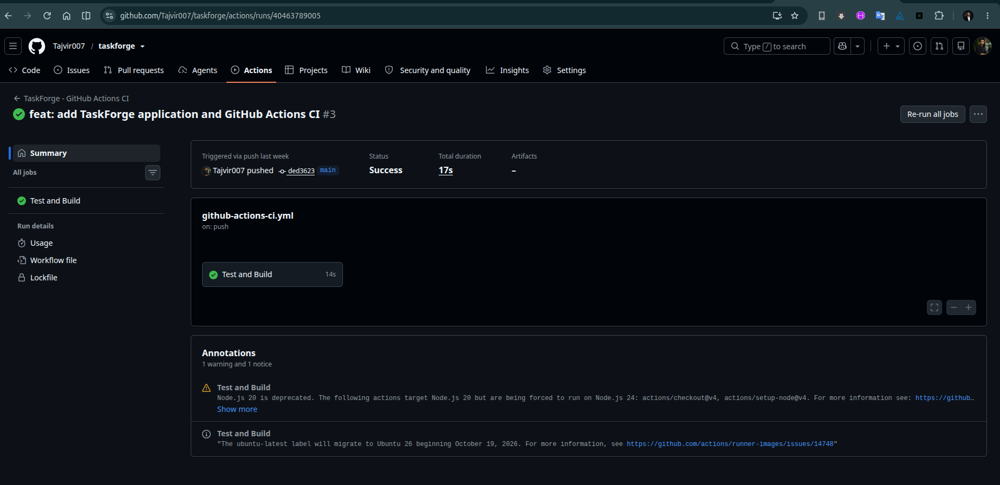
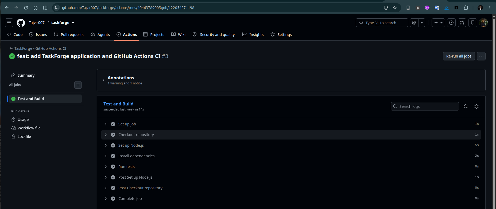

# ⚙️ TaskForge - GitHub Actions CI/CD

## 1. Objective

Automate TaskForge testing and Docker image builds using GitHub Actions.

## 2. Workflow Configuration

**Workflow File:**

`.github/workflows/github-actions-ci.yml`

## 3. Workflow Triggers

- Push to main
- Pull Request targeting main
- Manual workflow dispatch

## 4. Pipeline Execution Flow

1. Checkout source code
2. Set up Node.js 20
3. Install dependencies using npm ci
4. Run automated tests
5. Build Docker image

## 5. Implementation Progress

### Workflow Setup

- [ ] Create workflow YAML file
- [ ] Configure workflow triggers
- [ ] Configure permissions
- [ ] Configure jobs
- [ ] Configure steps

### CI Pipeline

- [ ] Checkout repository
- [ ] Setup Node.js
- [ ] Install dependencies
- [ ] Run automated tests
- [ ] Build Docker image

### Verification

- [ ] Workflow triggered successfully
- [ ] Dependency installation passed
- [ ] Tests passed
- [ ] Docker image build passed

## 6. Workflow Diagram


## 7. Commands Used

```bash
git add .
git commit -m "Add GitHub Actions CI"
git push origin main
```

## 8. Problems & Solutions

| Problem | Solution |
|---|---|
| Workflow failure | Check GitHub Actions logs |
| npm ci failure | Verify package-lock.json |
| Docker build failure | Check Dockerfile and build context |

## 9. Workflow Result

#### 1. Successful Workflow Run


#### 2. Job Execution Logs


## 10. Learning Notes

## 1. Introduction

By implementing the GitHub Actions CI pipeline for the TaskForge project, I learned how to automate application testing and Docker image building whenever code changes are pushed to GitHub.

This practical implementation helped me understand how Continuous Integration (CI) works in a real-world development workflow.

## 2. Key Concepts I Learned

### 2.1 Continuous Integration (CI)

- Understood what Continuous Integration is and why it is important.
- Learned how developers automatically validate code changes.
- Understood how CI helps identify errors before merging code into the main branch.
- Learned how automated pipelines reduce manual testing efforts.

### 2.2 GitHub Actions Fundamentals

- Understood GitHub Actions as a CI/CD automation platform.
- Learned the basic structure of a GitHub Actions workflow.
- Learned how to create workflow files using YAML.
- Understood the relationship between workflows, events, jobs, runners, and steps.

### 2.3 Workflow Triggers

Learned how to trigger workflows automatically using different GitHub events:

- `push`: Runs the workflow when code is pushed to the repository.
- `pull_request`: Runs the workflow when a pull request is opened or updated.
- `workflow_dispatch`: Allows manually triggering a workflow from GitHub.

Also understood how branch filters control where workflows execute.

### 2.4 GitHub Actions Workflow Structure

Learned the purpose of the following workflow components:

| Component | What I Learned |
|---|---|
| `name` | Defines the workflow name. |
| `on` | Defines when the workflow should run. |
| `permissions` | Controls the permissions granted to the workflow's `GITHUB_TOKEN`. |
| `jobs` | Defines the tasks to execute. |
| `runs-on` | Specifies the runner environment. |
| `steps` | Defines individual execution steps. |
| `uses` | Reuses an existing GitHub Action. |
| `run` | Executes shell commands. |
| `with` | Passes configuration inputs to an action. |

### 2.5 GitHub-Hosted Runners

- Learned what GitHub-hosted runners are.
- Understood how `ubuntu-latest` provides an Ubuntu environment for workflow execution.
- Learned that each job runs on a runner.
- Understood that the runner executes commands and workflow steps.

### 2.6 Repository Checkout

- Learned why source code must be available on the runner.
- Used `actions/checkout` to download the repository's source code.
- Understood how the workflow accesses project files after checkout.

### 2.7 Node.js Environment Setup

- Learned how to configure Node.js in a CI environment.
- Used `actions/setup-node` to install the required Node.js version.
- Understood why consistent runtime versions matter across development and CI environments.
- Learned how npm caching can help reduce dependency installation time.

### 2.8 Dependency Management

- Learned the difference between `npm install` and `npm ci`.
- Understood why `npm ci` is preferred in automated CI environments.
- Learned how `package-lock.json` helps maintain consistent dependency versions.
- Understood how dependency installation failures can stop a pipeline.

### 2.9 Automated Testing

- Learned how to execute application tests automatically using `npm test`.
- Understood how test failures affect the workflow status.
- Learned why automated testing should happen before building a Docker image.
- Understood how CI helps detect application-level issues early.

### 2.10 Docker Image Building

- Learned how to build a Docker image inside a GitHub Actions runner.
- Understood the role of a Dockerfile in defining an application image.
- Learned how to tag Docker images using the Git commit SHA.
- Understood why unique image tags are useful for identifying builds.

Example:

`taskforge:<github-commit-sha>`

### 2.11 Pipeline Execution Sequence

Understood the execution order of the CI pipeline:

1. A developer pushes code or creates a pull request.
2. GitHub detects the configured event.
3. The workflow starts automatically.
4. GitHub provisions an Ubuntu runner.
5. The repository is checked out.
6. The Node.js environment is configured.
7. Dependencies are installed using `npm ci`.
8. Automated tests are executed.
9. A Docker image is built.
10. GitHub displays the final workflow result.

### 2.12 Pipeline Failure and Troubleshooting

Learned how to:

- Identify failed workflow runs from the GitHub Actions tab.
- Read individual job and step logs.
- Understand errors related to missing npm scripts.
- Troubleshoot missing Dockerfiles and incorrect build contexts.
- Identify dependency and configuration problems.
- Re-run workflows after fixing issues.

### 2.13 GitHub Repository Documentation

- Learned how to document CI workflows in Markdown.
- Organized workflow screenshots inside the `docs/screenshots/` directory.
- Learned how to display screenshots in README files using relative image paths.
- Understood why technical documentation is important for project maintenance and portfolio presentation.

## 3. Practical Skills Gained

After completing this pipeline, I gained practical experience with:

- Creating GitHub Actions workflows.
- Writing YAML-based CI configuration.
- Configuring workflow triggers.
- Using GitHub-hosted Ubuntu runners.
- Automating Node.js dependency installation.
- Running application tests automatically.
- Building Docker images in CI.
- Using Git commit SHA for image tagging.
- Reading workflow execution logs.
- Troubleshooting CI failures.
- Documenting DevOps workflows.

## 4. What This Pipeline Does Not Yet Cover

This pipeline currently focuses on Continuous Integration. It does not yet perform the following operations:

- Push Docker images to Docker Hub or Amazon ECR.
- Perform automated deployment to AWS.
- Deploy applications to ECS or Kubernetes.
- Configure environment-specific deployment workflows.
- Implement advanced security scanning.

These can be implemented in future pipeline stages.

## 5. My Learning Outcome

Through this implementation, I gained a practical understanding of how Continuous Integration works using GitHub Actions.

I learned how to automate code checkout, environment setup, dependency installation, application testing, and Docker image building.

Most importantly, I understood how a code change can automatically trigger a sequence of validation and build operations, helping make the software development process more reliable and efficient.

**Project:** TaskForge  
**Pipeline:** GitHub Actions CI  
**Focus:** Continuous Integration, Node.js, npm, Docker, YAML, GitHub Actions
